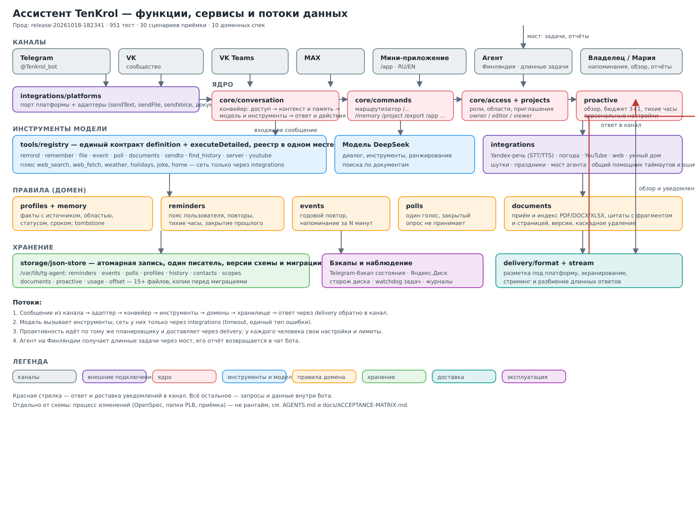

# Ассистент TenKrol

Домашний ассистент для двух человек: чат-бот в **Telegram** и **VK**, автономный агент для
длинных задач и **мини-приложение** внутри Telegram. Работает на двух серверах:
бот — на «Испании» (`185.174.136.53`), агент — на «Финляндии» (`185.106.94.155`).

## Что здесь лежит

```
tg-agent/   бот: чат, память, напоминания, проекты, документы, проактивность, мини-приложение
agent/      агент: песочница для длинных задач, мост к боту, сторож задач
openspec/   процесс: спеки доменов, папки изменений PLB-<номер>, архив
docs/       состояние (HANDOFF), план (ROADMAP), приёмка (acceptance), продуктовые спеки
secrets/    шифртекст секретов и имена ключей (без значений)
```

Подробности о возможностях бота — [tg-agent/README.md](tg-agent/README.md).

## Что умеет бот (кратко)

Напоминания и календарь, память с источником и управлением, проекты и права, документы как
источник ответов с цитатами, файлы на выход (PDF/Excel/Word/CSV), проактивный утренний обзор,
опросы, отправка сообщений другому человеку от вашего имени, длинные задачи через агента,
двуязычное мини-приложение, голосовые ответы, поиск по истории, статистика и состояние сервера.

## Мобильный сайт

`https://tenkrol.ru/mobile/` — отдельный пульт для телефона с входом по логину и паролю: планы,
память, чат с ботом и общий чат с Машей (ответы на сообщения свайпом, копирование, синхронизация личного и общего чата с Telegram), задания агенту по шаблонам, push-уведомления на iPhone, настройки и статистика. Поддерживаются несколько аккаунтов: у каждого
свой Telegram id и свои данные; владелец добавляет второго человека в «Настройки → Пользователи».
Пароли хранятся только scrypt-хешами; стартовый владелец задаётся в `.env`, дальше — в аккаунтах.
Подробности — [openspec/changes/PLB-026](openspec/changes/PLB-026/).

## Как это делается

Каждое изменение поведения — папка `openspec/changes/PLB-<номер>/` со спекой и задачами,
после проверки она уезжает в `openspec/changes/archive/`. Постоянные спеки доменов лежат в
`openspec/specs/`. Правила для любой сессии — [AGENTS.md](AGENTS.md) и
[openspec/conventions.md](openspec/conventions.md).

Продуктовые сценарии приёмки — [docs/acceptance/](docs/acceptance/), матрица готовности —
[docs/ACCEPTANCE-MATRIX.md](docs/ACCEPTANCE-MATRIX.md); прогон и отчёт:
`node tg-agent/tools/acceptance.mjs --run --report`. План работ — [docs/ROADMAP.md](docs/ROADMAP.md),
текущее состояние — [docs/HANDOFF.md](docs/HANDOFF.md).

## Быстрый старт

```sh
cd tg-agent
node --test --test-force-exit                       # тесты (сейчас 951)
node tools/acceptance.mjs --run --report            # приёмка: прогон и отчёт
node tools/acceptance.mjs --check                   # схема каталога приёмки
node tools/deploy-safe.mjs --notify --test-timeout 900000   # деплой с откатом
```

## Архитектура бота

`integrations → storage → domain → tools → core + delivery`.
Внешние подключения изолированы в `src/integrations/`, правила — в `src/domain/`,
инструменты — в `src/tools/` с реестром, ядро — `src/core/`, доставка — `src/delivery/`,
а `src/bot.mjs` остаётся тонким фасадом.

## Безопасность

- Секреты открытым текстом не хранятся: только шифртекст в `secrets/prod.env.enc`, пароль вне
  репозитория; имена ключей — `secrets/keys.md`.
- VPN/xray на «Испании» не трогается автоматикой; перезагрузка серверов — только с разрешения.
- Личные тексты и токены не попадают в публичные спеки, issues и логи.


## Оценка

Независимой приёмки не было; моя честная оценка с оглядкой на рынок — **7 из 10**, разбор по критериям и что даст +1: [docs/RATING.md](docs/RATING.md).

## Схема

 — каналы, ядро, инструменты, домены, хранение, доставка и потоки данных.
